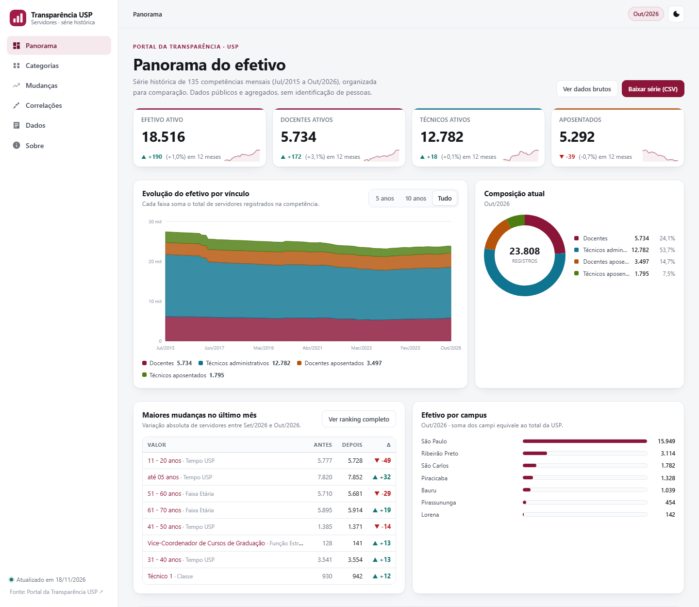
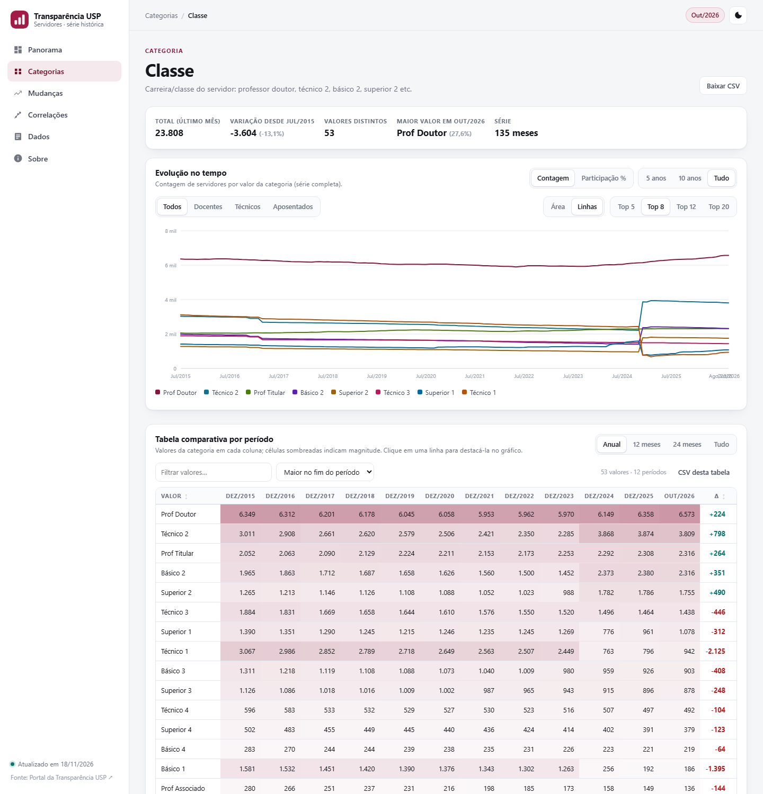
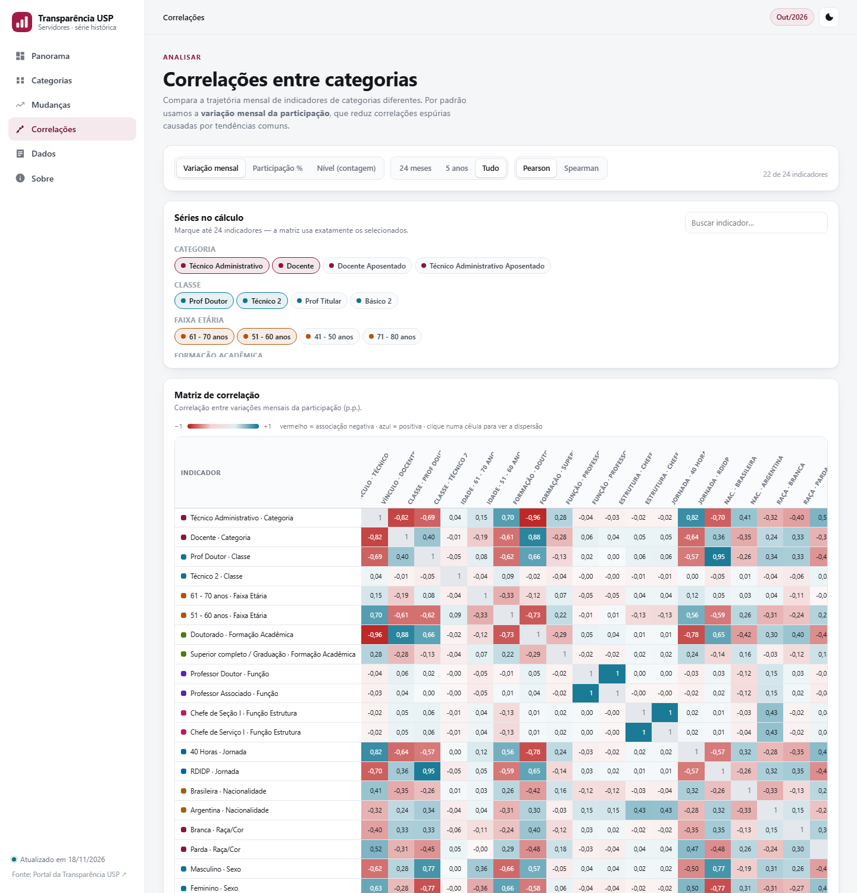
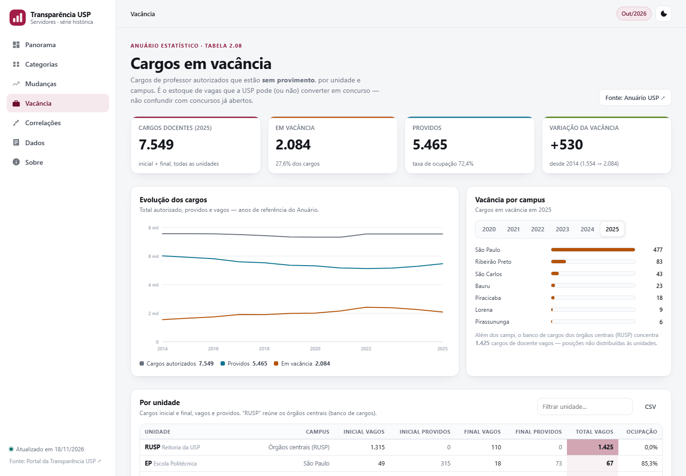
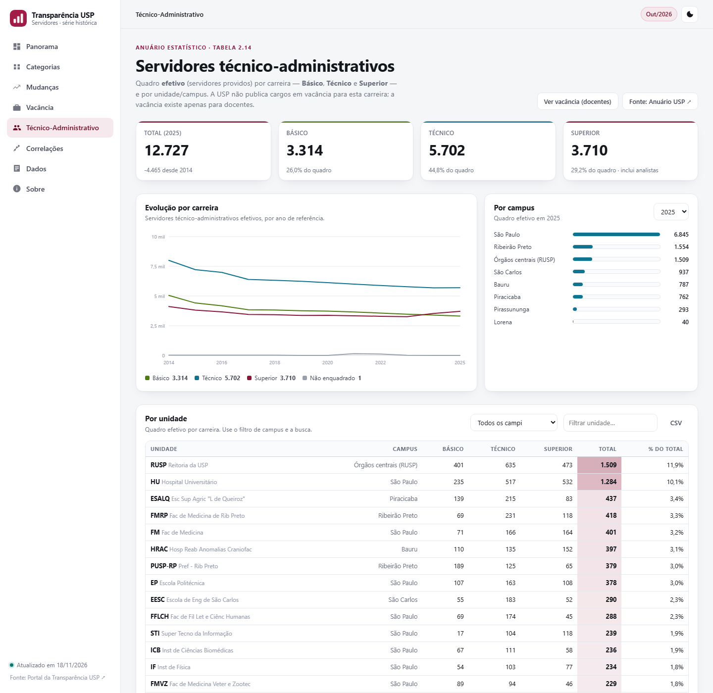

# Transparência USP — Servidores

Painel interativo (PWA) com a **série histórica do efetivo de servidores da USP**, extraída
do [Portal da Transparência da USP](https://uspdigital.usp.br/portaltransparencia/).

O portal original exibe os números em grades mensais de difícil comparação. Este projeto
transforma as 11 categorias publicadas em séries contínuas, com tabelas comparativas,
ranking de mudanças e análise de correlações.

**Acesse:** https://matheusdochapeu-hub.github.io/transparencia-usp/



| Categoria | Correlações |
| --- | --- |
|  |  |

| Vacância (docentes) | Técnico-Administrativo |
| --- | --- |
|  |  |

---

## O que tem no painel

| Área | Conteúdo |
| --- | --- |
| **Panorama** | KPIs do efetivo, evolução por vínculo, composição, maiores mudanças do mês e distribuição por campus |
| **Categorias** | 11 recortes, cada um com evolução mensal, tabela comparativa por período e comparador de dois meses |
| **Mudanças** | Ranking de todos os valores por variação (1 mês, 12 meses, 5 anos, série completa) |
| **Vacância** | Cargos de docente autorizados vs. providos (**vago/provido**) por unidade e campus, 2014–2025 |
| **Servidores** | Quadro efetivo da carreira técnico-administrativa por carreira (**Básico, Técnico, Superior**), **sexo** (2014–2025) e **raça/cor** (2020–2025), por unidade/campus |
| **Vencimentos** | Tabela salarial do DRH (grau/faixa × letra, classes B/T/S) com evolução **nominal e real** contra **IPCA, IGP-M e INPC** (2011–2026) |
| **Movimento** | Saldo líquido anual do quadro técnico-administrativo por campus/unidade — quem ganhou e quem perdeu servidores, e em que ano |
| **Correlações** | Matriz de correlação entre indicadores de categorias diferentes, com dispersão, reta de regressão e p-valor |
| **Dados** | Tabela completa, dicionário de dados e exportações CSV/JSON |

As categorias disponíveis são: **Categoria (vínculo), Classe, Faixa Etária, Formação Acadêmica,
Função, Função Estrutura, Jornada, Nacionalidade, Raça/Cor, Sexo e Tempo USP.**

### Recorte por campus e unidade

O seletor no topo filtra **todo o painel** por campi (histórico completo, 2015–2026) ou por
unidade (últimos 24 meses): panorama, categorias, comparador de períodos e ranking de mudanças
passam a refletir apenas aquele recorte. Deep link: `?scope=campus-10` ou `?scope=unit-EACH`.

## Importar a vacância de servidores (extrato do DRH)

A USP **não publica** cargos em vacância da carreira técnico-administrativa. Quando o DRH
enviar o extrato (LAI, e-mail ou relatório), o painel já está pronto para exibi-lo:

```bash
python scripts/import_vacancia.py --input extrato_drh.csv \
  --source "DRH - resposta de 2026-12-01"
python scripts/build.py
```

Formato esperado (CSV com `;` ou XLSX), uma linha por combinação:

```
competencia;unidade;campus;carreira;classe;letra;situacao;quantidade
2026-10;EACH;São Paulo;Superior;S1;A;provido;12
2026-10;EACH;São Paulo;Superior;S1;A;vago;3
```

- `competencia`: `AAAA-MM`
- `carreira`: `Basico` | `Tecnico` | `Superior` (aceita acentos e maiúsculas)
- `situacao`: `provido` | `vago` (aceita “não provido”)
- `campus`, `classe` e `letra` são opcionais (o campus é preenchido pelo mapa unidade→campus)

Exemplo fictício pronto para teste em `samples/vacancia-servidores-exemplo.csv`.
O importador valida as linhas, agrega por competência/unidade/carreira e grava
`data/vacancia-servidores.json`; o build publica em `docs/data/` e a aba **Vacância**
passa a mostrar a seção “Vacância de servidores”.

## Fonte e cobertura

- **Fonte principal:** Portal da Transparência da USP — “Busca de Servidores”.
- **Cobertura:** Jul/2015 até a competência mais recente (o limite inicial é do próprio portal).
- **Granularidade:** mensal, contagens agregadas.
- **Campi:** 7 (São Paulo, Bauru, Piracicaba, Pirassununga, São Carlos, Ribeirão Preto, Lorena).
- **Vacância:** Anuário Estatístico da USP, Tabela 2.08 (Quadro de Docentes efetivos), 2014–2025.
- **Quadro técnico:** Anuário Estatístico da USP, Tabela 2.14 (Básico/Técnico/Superior), 2014–2025.
- **Privacidade:** nenhum dado individual; apenas totais já publicados pela USP.

> **Sobre “vagas”:** a USP **não publica** cargos em vacância de técnicos administrativos — esse número existe apenas no Banco de Cargos interno. Para docentes, o Anuário publica anualmente `vago`/`provido` por unidade. Cargo vago ≠ concurso aberto: a abertura de edital é decisão da Reitoria/CAA.

### Validação

- A soma de cada categoria confere, mês a mês, com o total oficial de vínculos.
- A soma dos 7 campi confere com o total da USP na competência.
- Os números foram conferidos contra o **export CSV do próprio portal** (mesmo endpoint de “Exportar CSV” da página).
- Lacunas do portal (ex.: jul/2026, sem publicação) são omitidas da série em vez de virar zero.

## Como a extração funciona

O portal não oferece API REST: as tabelas são carregadas por **DWR** (Direct Web Remoting).
O extrator fala diretamente com o endpoint DWR usado pela própria página, o que garante que
os números sejam idênticos aos exibidos no site:

```
listarReferencia()                         -> competências disponíveis
listarInfoServidor(procedimento, data, und, campus)
```

Cada competência é salva como um snapshot em `data/raw/AAAA-MM.json`. O histórico é
**versionado no repositório** — nada é sobrescrito.

```
scripts/extract.py        extração mensal do portal (incremental, com retry)
scripts/extract_vagas.py  vacância de docentes (XLS do Anuário, 2014–2025)
scripts/build.py          normaliza snapshots -> docs/data/*.json + CSV
scripts/make_icons.py     gera os ícones da PWA
```

### Rodar localmente

```bash
pip install xlrd
python scripts/extract.py --full          # baixa todo o histórico (~15 min)
python scripts/extract_vagas.py           # vacância de docentes (Anuário)
python scripts/build.py                   # gera os dados do painel
python -m http.server 8000 --directory docs
# abra http://localhost:8000
```

Não há etapa de build para o front-end: é HTML/CSS/JS puro (ES modules), sem dependências.

## Automação mensal

`.github/workflows/update-data.yml` roda no **dia 5 de cada mês** (09:00 UTC):

1. extrai apenas competências novas (reaplicando os 2 meses mais recentes);
2. regenera `docs/data/`;
3. faz commit e push somente se houver mudança.

O GitHub Pages publica a pasta `docs/` a cada push. Também é possível disparar manualmente
pelo botão *Run workflow*.

## Estrutura

```
data/raw/            snapshots mensais brutos (fonte da verdade)
data/vagas/          T2.08 do Anuário + mapa unidade -> campus
docs/                PWA publicada no GitHub Pages
  data/              dados normalizados + CSV
  js/                aplicação (ES modules, sem dependências)
  sw.js              service worker (offline)
.github/workflows/   automação mensal
```

## Limitações

- A série começa em Jul/2015 por limitação do portal.
- Revisões retroativas feitas pela USP podem alterar meses antigos.
- “Função Estrutura” cobre apenas servidores ativos em funções de chefia/coordenação, por isso
  seu total é menor que o efetivo geral.
- Correlações são exploratórias e não estabelecem causalidade.

## Licença

Código sob MIT. Os dados são públicos e de responsabilidade da fonte original.
